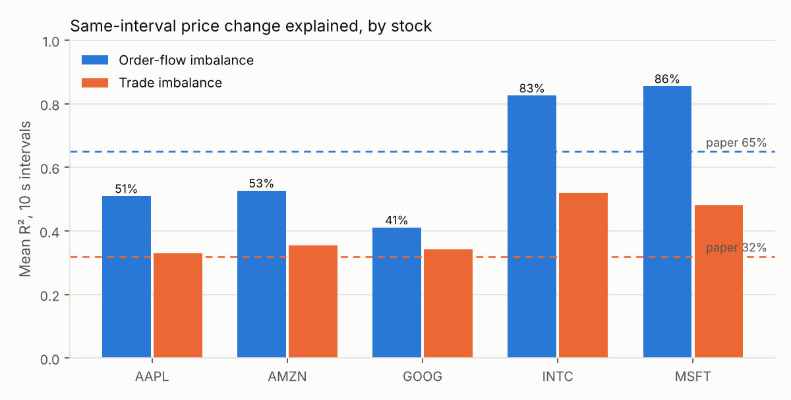
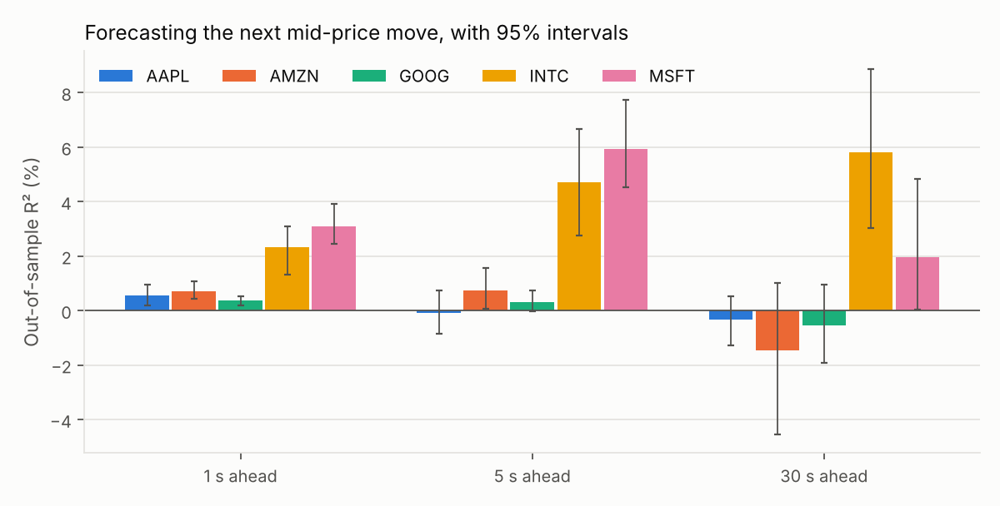
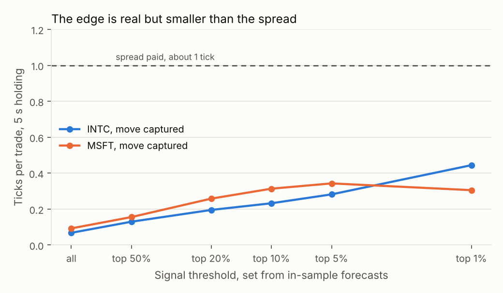
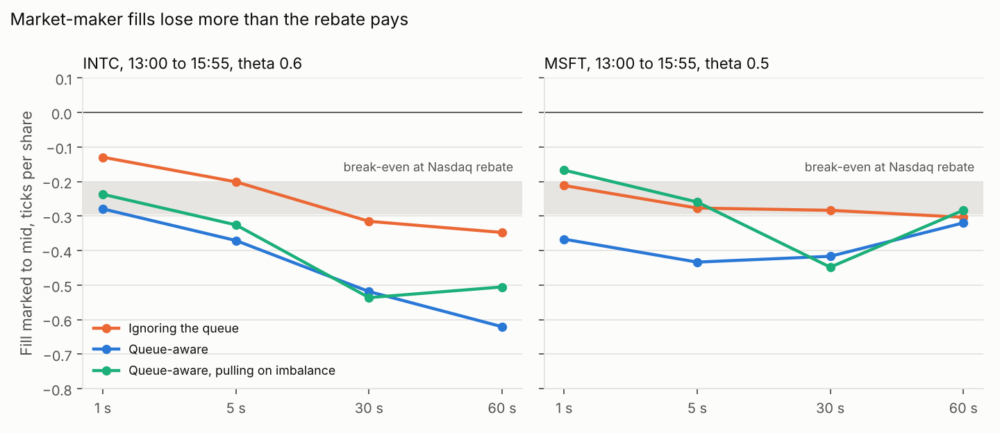
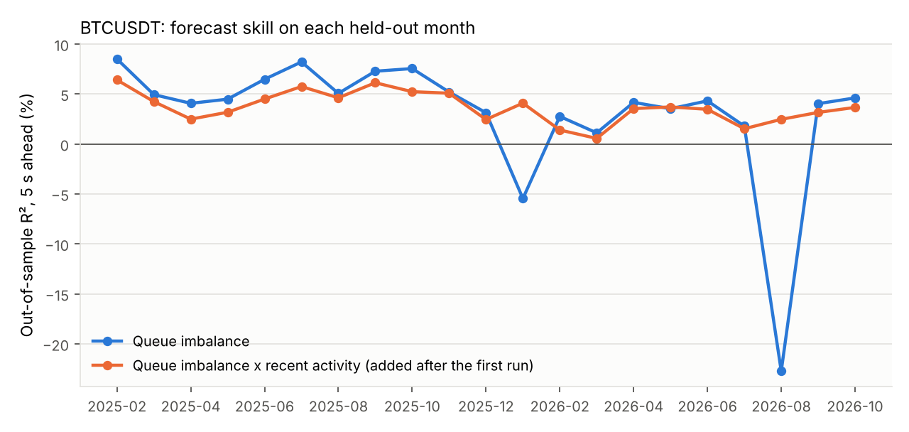

# Order-flow imbalance on Nasdaq tick data

Does the imbalance between buying and selling pressure at the top of the order book predict the next mid-price move, and is that prediction worth anything after paying the spread?

This study answers that on 2,110,860 Nasdaq messages for AAPL, AMZN, GOOG, INTC and MSFT (LOBSTER sample day, 21 June 2012). It first replicates a published result, then tests prediction out of sample with leak-free validation, then prices the result for a taker and, with a queue-position simulator, for a market maker. A C++ engine computes the features and is checked against the Python reference on every one of the 2.1 million events.

The same pipeline then runs on 31,696,550 top-of-book updates for Binance's BTCUSDT perpetual over 24 recent days, one a month from November 2024 to October 2026; see [Binance futures](#binance-futures-24-days).

## Results in brief

Every number below is generated by `run_all.py` and appears in [`results/results.md`](results/results.md).

- **The published result replicates.** Order-flow imbalance (OFI) explains on average 62.5% of the variance of 10-second mid-price changes across the five stocks, against 65% in Cont, Kukanov and Stoikov (2014). Trade imbalance explains 40.5% (32% in the paper). Price impact per share falls with depth with an exponent of 0.97 (standard error 0.25), against 0.98 in the paper.
- **OFI explains the price move as it happens, but barely predicts the next one.** Lagged OFI alone reaches an out-of-sample R² of at most 0.70% five seconds ahead.
- **Queue imbalance does predict, but only in large-tick stocks.** In INTC and MSFT, where the spread is one tick almost all day, a linear model on queue imbalance and lagged OFI reaches an out-of-sample R² of 4.71% (95% interval 2.74 to 6.66) and 5.92% (4.51 to 7.73) five seconds ahead, and calls the direction of the next mid move correctly 74.0% and 71.9% of the time. In AAPL, AMZN and GOOG, with spreads of 12 to 25 ticks, it is close to zero.
- **A one-second timestamp leak manufactures a strategy.** Binning events by second and labelling each bin by its start lifts INTC's one-second R² from 0.22% to 80.2% and its hit rate from 60.4% to 99.4%. The no-lookahead test in `tests/` catches this mistake.
- **The signal transfers within a tick regime, not across.** A model fitted on INTC's morning scores 5.43% on MSFT's afternoon, close to MSFT's own 6.10%. Models fitted on the small-tick stocks score between -12% and -60% on the large-tick ones.
- **It does not pay a taker.** With thresholds set from in-sample forecasts, trading only the strongest 1% captures 0.444 ticks per trade in INTC and 0.305 in MSFT over five seconds, while paying about one tick in spread, half on entry and half on exit. No stock, horizon or threshold covers the spread, and the best case, INTC over 30 seconds, covers 62% of it. Nasdaq's $0.0030 taker fee, another 0.30 ticks each way, is not included and would widen the gap.
- **Ignoring the queue flatters a market maker.** Assuming every quote sits at the front of the queue fills 3.75 times as many shares in INTC and 3.49 times in MSFT, and makes each fill look 0.178 and 0.135 ticks better 30 seconds later.
- **With the queue modelled, the maker loses more than the rebate pays.** A maker who always joins the back of the queue at the best bid and ask earns half a tick at the fill, then loses it and more: marked to the mid 30 seconds later, fills lose 0.445 ticks a share in INTC and 0.415 in MSFT. Nasdaq paid makers 0.20 to 0.295 ticks a share in 2012. Under the most optimistic assumption about emptied price levels the loss is still 0.380 and 0.357.
- **Pulling quotes on queue imbalance does not rescue it.** With the threshold chosen on the morning and run once on the afternoon, 5-second losses fall (MSFT from 0.433 to 0.259 ticks a share) but 30-second losses do not (0.416 to 0.448), and volume drops to 9 to 17% of the baseline. With half a millisecond of latency the 5-second gain disappears too. So the claim this study set out to test, that the edge belongs to a market maker, does not survive a queue model on this day.






## Method

**Data checks first.** Every message is replayed against the level-1 book. A message at the best price must change the best size by exactly its size, or empty the level, and a message away from the best must leave level 1 alone. All 2,110,860 messages pass. The checks also confirm sorted timestamps, no crossed or empty books and no halts, and count the 156,171 messages that share a timestamp with another.

**Features.** OFI follows the event definition in Cont, Kukanov and Stoikov (2014). Queue imbalance is (bid size - ask size) / (bid size + ask size) at the best quotes. OFI windows of 1, 5 and 30 seconds are scaled by average depth over the previous five minutes, using only past data.

**No lookahead by construction.** Every feature at time t uses events with time at or before t. Every label is the mid-price change over (t, t+h]. A test perturbs every event after a cutoff and checks that no feature before the cutoff, and no label ending before it, changes.

**Validation.** Walk-forward by half-hour block, training on all earlier blocks and testing on the next. Training rows whose label window reaches into the test block are dropped, which is an embargo against overlapping labels. Feature clipping bounds come from the training rows only. Out-of-sample R² is measured against a forecast of no change. Confidence intervals come from a moving-block bootstrap with 5-minute blocks, which keeps the autocorrelation that overlapping labels create.

**Transfer.** Models are fitted on one stock from 09:30 to 13:00 and tested on another from 13:00 to 16:00. Splitting in time as well as across stocks matters, because the stocks move together and a same-minute test would leak the common move.

**Costs.** A taker trades the sign of the forecast, crossing the spread at t and again at t+h. Trading thresholds are quantiles of the in-sample forecasts from the same walk-forward step, so the rule could have been set before each test block.

**Market maker with queue position.** `src/lobofi/maker.py` quotes 100 shares at the best bid and ask in INTC and MSFT, rejoins at the back of the queue after each fill, and holds at most 1,000 shares. LOBSTER's order IDs make the queue exact under first-in-first-out priority: when the maker joins, every displayed share at that price is ahead of it; executions at that price eat the front of the queue first; a cancellation shrinks the queue ahead only if that order arrived before the maker joined. A test checks on every message of the day that the queue ahead never exceeds the displayed size. Assumptions:
- the maker's 100 shares do not change anyone else's behaviour;
- hidden executions never fill it;
- orders take effect after a fixed latency (0 to 50 ms tested);
- if a price level empties while the maker is still in it, the maker is counted as filled there, because it is the last order at a price the market is leaving. Cancelling instead is reported as the optimistic bound.

Fill quality is measured by markout: each fill marked to the mid-price 1, 5, 30 and 60 seconds later. Confidence intervals resample 5-minute buckets of fills.

**Engineering.** `cpp/ofi_engine.cpp` streams the raw file and computes OFI and grid samples in one pass, at 1.8 to 2.6 million events per second per stock on a 2-core cloud machine, including CSV parsing. `tests/test_cpp_engine.py` checks that it matches the Python reference exactly on every event of every stock.

## What this does not show

- **One day, five stocks, 2012.** The day and the stocks are fixed by the free LOBSTER sample, and market structure has changed since. These are case-study results, not estimates of a durable edge.
- **Level 1 only.** Deeper levels may carry more information, and they are not in this extract.
- **One maker strategy.** The simulated maker always joins the back of the queue and rejoins after every fill. A real maker would hold queue position across ticks and lean its quotes with inventory, which this does not test.
- **One Binance day a month.** The 24 days are the free first-of-month files, so they cover two years but not consecutive days, and three of them are unusually quiet.
- **Linear models.** These are deliberately simple so that every coefficient can be read. A nonlinear model might do better on the small-tick stocks.

## Reproduce

```
pip install -r requirements.txt
scripts/get_data.sh        # downloads the five files and checks their SHA-256
make -C cpp
python -m pytest           # 37 tests, about 30 s
python run_all.py          # about 1.5 minutes, rewrites results/ and figures/
```

## Binance futures (24 days)

Binance stopped publishing its own futures best-bid-and-ask files in March 2024, so recent days come from Tardis.dev, which publishes the first day of every month free. `run_crypto.py` downloads each day of BTCUSDT `quotes`, streams it into the same 1-second grid in chunks so memory stays flat, deletes the raw file, and runs the same features, the same replication check and the same out-of-sample test as the Nasdaq study. Here the windows are whole days: fit on every earlier month and test on the next, which gives 21 test days. Costs are in basis points and include Binance's regular-account fees (0.02% maker, 0.05% taker). Features are timed by when each update was received, not by the exchange's timestamp. Full results are in [`results/crypto_results.md`](results/crypto_results.md).

- **Clean data.** All 31,696,550 updates pass: no crossed books, no empty sides and no receipt times going backwards. The spread is one tick (0.1 USDT) 98.5% to 99.9% of the time.
- **The replication holds in a different market and decade.** OFI explains 68.0% of 10-second mid changes on average, against 65% in the paper and 62.5% on Nasdaq in 2012.
- **Queue imbalance predicts across months.** Fitted on earlier months and tested on the next, it reaches an out-of-sample R² of 6.08% one second ahead (95% interval 4.69 to 7.18) and 4.19% five seconds ahead (3.27 to 5.21), calling the direction right 80.3% and 68.4% of the time. Five seconds ahead that is close to the Nasdaq one-tick stocks in 2012 (4.71% and 5.92%). Lagged OFI adds little.
- **Its direction travels between months but its size does not.** The three test days where it fails at one second (Nov 2025, Jan 2026, Aug 2026) are the three quietest. Five seconds ahead, they were its three best days for calling direction (78% to 82%, against at most 74% on any other day), but its forecasts were 1.6 to 3.9 times too large, because the model was sized on busier months.
- **Scaling by recent activity fixes one horizon and hurts the others.** Multiplying queue imbalance by the last five minutes' average price movement makes every test day positive one second ahead and lifts R² to 7.56%, including on the 18 days that did not prompt it (7.65% against 6.66%). But it lowers R² at 5 and 30 seconds. It was added after seeing the first run, so it is a lead for the next months of data, not a tested result.
- **Fees end it.** The best signals capture at most 0.85 bp per round trip, against a spread of about 0.015 bp and 10 bp of taker fees. Even a maker paying 2 bp a side would need 4 bp.



```
python run_crypto.py --months 6    # quick first run
python run_crypto.py               # all 24 days, about 1.5 minutes plus the download
```

The 24 files total about 0.5 GB and are deleted after processing. Days already processed are skipped, so an interrupted run resumes. Besides the real run, the pipeline is tested on synthetic files in Tardis's exact format: chunked and in-memory processing agree, no feature sees the future, off-grid prices are refused, and a planted queue-imbalance effect is found end to end. The real results reproduce to within 1e-12 on a second machine.

## Layout

| Path | What it does |
|---|---|
| `src/lobofi/io.py` | Loading and LOBSTER conventions |
| `src/lobofi/checks.py` | Replays every message against the level-1 book |
| `src/lobofi/features.py` | OFI, queue imbalance, as-of sampling, causal windows |
| `src/lobofi/studies.py` | Replication, walk-forward prediction, leak demonstration, transfer, costs |
| `src/lobofi/report.py` | Writes `results/results.md` and `figures/` from the run |
| `src/lobofi/maker.py` | Queue-position market-making simulator and its study |
| `src/lobofi/crypto.py`, `crypto_report.py` | Binance futures download, streaming day processing, study across months |
| `cpp/ofi_engine.cpp` | One-pass C++ engine for OFI and grid sampling |
| `tests/` | OFI definition, no-lookahead, embargo, data integrity, C++ against Python, hand-checked queue cases, Binance pipeline |

## References

- Cont, R., Kukanov, A. and Stoikov, S. (2014). The price impact of order book events. *Journal of Financial Econometrics*, 12(1), 47-88.
- Gould, M. D. and Bonart, J. (2016). Queue imbalance as a one-tick-ahead price predictor in a limit order book. *Market Microstructure and Liquidity*.
- Moallemi, C. C. and Yuan, K. (2016). A model for queue position valuation in a limit order book. Working paper, Columbia Business School.
- Nasdaq Rule 7018 fee schedule, SR-NASDAQ-2012-053 (SEC release 34-66915).
- Huang, R. and Polak, T. (2011). LOBSTER: Limit order book reconstruction system. Data from lobsterdata.com.
